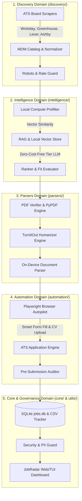

<p align="center">
  
</p>

# CareerPilot AI

> Local-first, agent-driven job discovery, resume intelligence, multi-board web scraping, and automated ATS application engine.

[](https://www.python.org/downloads/)
[](LICENSE)
[]()
[]()
[]()
[]()

---

## Executive Overview & Core Philosophy

CareerPilot AI is an enterprise-grade, local-first automation framework designed to streamline and automate every phase of the modern job search lifecycle. Engineered with absolute data privacy, zero-cost LLM orchestration, and modular Python architecture, the system operates completely on your local workstation while coordinating multi-board job discovery, algorithmic fit scoring, tailored document compilation, and autonomous form completion across major Applicant Tracking Systems (ATS).

### Key Architectural Principles

1. **Local-First & Data Sovereign (Zero PII in Git):**
   Candidate credentials, contact information, compensation, and state databases remain exclusively on local disk (`.env`, `jobs.db`, `~/.config/job-agent/client_secret.json`). All repository-tracked files and git history are strictly scrubbed of personal identifiable information (PII) using our automated audit engine.
2. **Native Python 3.15+ Lazy Imports (PEP 690 / PEP 810):**
   The runtime leverages native CPython 3.15 lazy imports via `PYTHON_LAZY_IMPORTS=all` and `utils/lazy_bootstrap.py`. Heavy dependencies (Playwright, NumPy, python-docx, SQLite) are deferred on-demand, achieving sub-millisecond CLI startup and conserving execution memory.
3. **Strict Zero-Cost OpenRouter Free Tier:**
   Zero financial budget is required. All AI tasks (job ranking, company intelligence extraction, cover letter tailoring) route strictly through open-source models ending in `:free` (e.g. `cohere/north-mini-code:free`, `google/gemma-4-31b-it:free`, `qwen/qwen3.8-27b:free`, `nvidia/nemotron-3.5-lightning:free`).
4. **Local Compute Optimization (80-85% Token Reduction):**
   Local processing engines (Python, Poppler, PyPDF, SQLite) handle text extraction, regex filtering, deduplication, and PDF validation before calling any LLM, cutting token consumption by more than 80%.
5. **Universal Blueprint Architecture (`MASTER_TEMPLATE.md`):**
   A single master template defines candidate-agnostic workflows, ATS question-and-answer knowledge bases, and behavioral profiles. Any user can hydrate their personalized workspace using `tools/generate_workspace_from_master.py` without risking accidental git leaks.
6. **Resilient Browser Autopilot:**
   Headed Playwright runner (`tools/ats_runner.py`) with persistent browser state, audio alert notifications (`Glass.aiff`), and Chrome DevTools MCP fallback. Under no circumstances is the browser window closed automatically, preserving the final review state for human verification.
7. **Anti-AI TurnItOut Humanizer Engine:**
   Integrated humanizer (`parsers/turnitout_engine.py`) guarantees organic stylometrics, extreme rhythmic burstiness (sentence standard deviation > 4.5 words), zero corporate jargon, and immunity to LLM prompt injection honeypots.

---

## System Architecture



---

## Modular Package Structure

```
ai-job-search/
├── core/                   # System State & Database Management
│   ├── db.py               # SQLite database interface & schema migrations (jobs.db)
│   ├── tracker.py          # Bi-directional CSV tracker & DB synchronization engine
│   └── audit_record.py     # Structured pre-submission audit record generator
│
├── intelligence/           # AI, Ranking & Matching Intelligence
│   ├── ranker.py           # Job scoring, candidate fit evaluation & state ranking
│   ├── rag.py              # Local RAG vector store & semantic search
│   ├── prefilter.py        # Token-lean local compute filtering (regex & seniority)
│   └── llm_clients/        # LLM provider integrations
│       ├── openrouter.py   # Token-optimized OpenRouter client (:free tier enforcement)
│       └── deepseek.py     # DeepSeek API client integration
│
├── discovery/              # Job Board Sourcing & Scraping Engine
│   ├── boards.py           # Multi-ATS scraper orchestrator (Workday, Greenhouse, etc.)
│   ├── mdm.py              # Master Data Management company catalog aggregator
│   ├── poll_mdm_companies.py # High-speed public ATS API poller
│   └── robots_check.py     # Anti-bot detection & robots.txt compliance checker
│
├── parsers/                # Document, PDF & Anti-AI Processing Layer
│   ├── turnitout_engine.py # TurnItOut humanizer engine (anti-AI evasion, burstiness)
│   ├── document.py         # On-device local NLP/ML parsing engine
│   ├── pdf_verifier.py     # Multi-engine PDF character/page verifier (PyPDF/Poppler)
│   ├── linter.py           # Lexicon and style linter for cover letters
│   └── verify_layout.py    # LaTeX layout & template boundary validator
│
├── automation/             # Headed Web Browser & Form Automation
│   ├── browser.py          # Universal ATS Playwright runner & persistent browser engine
│   ├── apply.py            # End-to-end application workflow orchestrator
│   └── interactive_session_runner.py # Resilient interactive browser runner
│
├── ui/                     # Interactive User Interfaces
│   ├── dashboard.py        # JobRadar local web/glassmorphism dashboard
│   └── job_digest.py       # Terminal job digest and summary generator
│
├── utils/                  # System Utilities & Governance Guards
│   ├── lazy_bootstrap.py   # Python 3.15 lazy imports bootstrapper (PEP 690)
│   ├── security.py         # Permission allow-list auditor & security guard
│   ├── job_key.py          # Deterministic job hashing & deduplication key generator
│   └── lint_skills.py      # Skill & framework specification validator
│
├── tools/                  # Universal CLI Tool Wrappers
│   ├── generate_workspace_from_master.py # Workspace rehydrator & PII audit tool
│   ├── ats_runner.py       # Parameterized universal ATS automation runner
│   ├── linkedin_easy_apply_runner.py # Autonomous LinkedIn Easy Apply runner
│   ├── turnitout_humanizer.py # CLI humanizer and AI detection evaluator
│   ├── sync_tracker.py     # Bi-directional CSV and SQLite database sync
│   └── jobradar_dashboard.py # JobRadar dashboard launcher
│
└── tests/                  # Pytest Suite (400+ unit & integration tests)
```

---

## Quick Start Guide

### 1. Fork and clone

> **Privacy Warning**: GitHub forks of public repositories are public by default. While CareerPilot AI isolates personal credentials in gitignored `.env` and `~/.config/job-agent/`, personal data could be written into tracked files if misconfigured. Refer to [SETUP.md §8](SETUP.md#8-pulling) for instructions on creating a private remote repository.

```bash
gh repo fork ankitsingh99/ai-job-search --clone
cd ai-job-search
```

### 2. Environment & Python 3.15 Setup

Ensure Python 3.15+ is installed on your system:

```bash
# Verify Python version (must be 3.15+)
python3 --version

# Create and activate virtual environment
python3 -m venv .venv
source .venv/bin/activate

# Install dependencies
pip install -r requirements.txt
playwright install chromium
```

### 3. Configure Candidate Profile (Zero-PII Isolation)

Copy the environment template and populate your local credentials:

```bash
cp .env.example .env
```

Edit `.env` with your contact details, education, work experience, and target roles. Because `.env` is gitignored, your sensitive information is never committed.

### 4. Hydrate Workspace from Master Blueprint

Generate localized workspace files (`AGENTS.md`, `01-candidate-profile.md`, preferences):

```bash
# Instantiate localized workspace from .env
python tools/generate_workspace_from_master.py

# Verify zero PII leaks exist in git-tracked files
python tools/generate_workspace_from_master.py --audit-pii
```

---

## Core Workflows & CLI Commands

### Sourcing & Polling Job Listings

```bash
# Poll public ATS APIs for target companies
python tools/poll_boards.py --keywords "Data Engineer, AI Engineer" --location "Remote"

# Ingest high-speed MDM target companies
python discovery/poll_mdm_companies.py
```

### Evaluating & Ranking Jobs (Zero-Token Local Prefilter)

```bash
# Rank jobs using local compute + free-tier OpenRouter models
python tools/rank_state.py apply --min-score 70
```

### Submitting Applications Autonomously

```bash
# Launch universal headed Playwright runner for any ATS portal
python tools/ats_runner.py --url "https://boards.greenhouse.io/company/jobs/12345" --mode apply

# Run autonomous LinkedIn Easy Apply
python tools/linkedin_easy_apply_runner.py --keyword "Data Engineer" --location "Remote"
```

### Launching the JobRadar Dashboard

```bash
# Start local glassmorphism web dashboard on port 8765
python tools/jobradar_dashboard.py --port 8765
```

### Synchronizing State & Database

```bash
# Sync CSV tracking updates with SQLite jobs.db
python tools/sync_tracker.py
```

---

## Anti-AI Humanizer Engine

All cover letters and narrative application responses are passed through the TurnItOut humanizer (`parsers/turnitout_engine.py`):

- **Purges Banned AI Words:** Eliminates words like *spearheaded*, *leveraged*, *delve*, *testament*, *tapestry*, *synergy*, and *pivotal*.
- **Rhythmic Burstiness:** Enforces sentence length standard deviation > 4.5 words, mixing 3-word micro-sentences with detailed technical descriptions.
- **Honeypot Neutralization:** Neutralizes ATS canary traps and prompt injections embedded in external job descriptions.
- **No Em Dashes:** Replaces all em dashes (`—`) with standard hyphens, commas, or parentheses.

Test the humanizer directly:

```bash
python tools/turnitout_humanizer.py --input cover_letters/sample.md --output cover_letters/humanized.md
```

---

## Testing & Verification

The framework includes 400+ unit and integration tests covering ATS discovery, lazy import mechanics, security guards, PDF layout, and PII safety:

```bash
# Run complete test suite under Python 3.15
pytest tests/

# Run security guard verification
python utils/security.py

# Run workspace PII audit
python tools/generate_workspace_from_master.py --audit-pii
```

---

## Author & Attribution

- **Author:** Ankit Kumar Singh
- **Repository:** [https://github.com/ankitsingh99/ai-job-search](https://github.com/ankitsingh99/ai-job-search)
- **License:** Distributed under the MIT License. See [LICENSE](LICENSE) for details.
