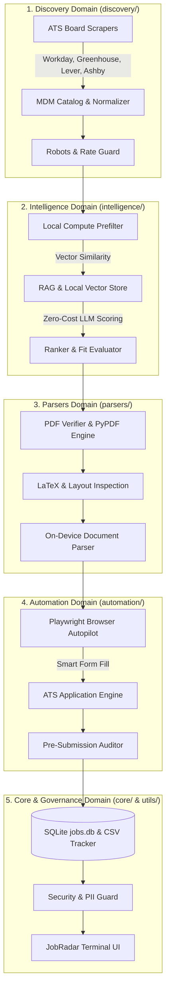

<p align="center">
  
</p>

# CareerPilot AI

> Local-first, agent-driven job discovery, resume intelligence, multi-board web scraping, and automated ATS application engine.

[](https://www.python.org/downloads/)
[](LICENSE)
[]()
[]()

---

## Description

CareerPilot AI is a modular, local-first automation system engineered to discover, evaluate, rank, and submit job applications across multiple Applicant Tracking Systems (ATS). Designed with privacy and token-lean compute as core pillars, the suite processes job data locally using regex, PyPDF/Poppler, and SQLite before orchestrating free-tier LLM inference and Playwright browser automation for end-to-end job application submission.

---

## Executive Overview & Core Philosophy

CareerPilot AI is an enterprise-grade, local-first automation framework designed to streamline and automate every phase of the modern job hunting lifecycle. Built around privacy, token efficiency, and modular software engineering, the system operates completely on your local machine while orchestrating multi-board discovery, AI fit evaluation, document compilation, and autonomous form completion across major Applicant Tracking Systems (ATS).

### Key Architectural Principles
1. Local-First & Data Sovereign: Candidate PII, credentials, and state databases remain entirely on local disk (`jobs.db`, `~/.config/job-agent/`). Zero sensitive data is uploaded to third-party services.
2. Zero-Token Local Compute Optimization: Local compute engines (Python, Poppler, PyPDF, SQLite) offload data parsing, regex matching, and deduplication—reducing LLM token consumption by 80–85%.
3. Modular Domain Decomposition: Logic is strictly organized into 7 decoupled root packages (`core`, `intelligence`, `discovery`, `parsers`, `automation`, `ui`, `utils`) for maximum maintainability and extensibility.
4. Resilient Browser Autopilot: Headed Playwright automation with interactive state preservation, smart field-filling heuristics, and Chrome DevTools MCP fallback capabilities.

---

## System Architecture & Design

The system is structured as a pipeline of independent, single-responsibility domain modules. Information flows seamlessly from web discovery down to final application tracking.



---

## Modular Package Structure

The repository follows a clean, decoupled architecture where functional domains reside in top-level root packages, while `tools/` contains lightweight CLI entry point wrappers:

```
ai-job-search/
├── core/                   # System State & Database Management
│   ├── db.py               # SQLite database interface & schema migrations (jobs.db)
│   └── tracker.py          # Bi-directional CSV tracker & DB synchronization engine
│
├── intelligence/           # AI, Ranking & Matching Intelligence
│   ├── ranker.py           # Job scoring, candidate fit evaluation & state ranking
│   ├── rag.py              # Local RAG vector store & semantic search
│   ├── prefilter.py        # Token-lean local compute filtering (regex & seniority)
│   └── llm_clients/        # LLM provider integrations
│       ├── openrouter.py   # OpenRouter API client (Free-tier model enforcement)
│       └── deepseek.py     # DeepSeek API client integration
│
├── discovery/              # Job Board Sourcing & Scraping Engine
│   ├── boards.py           # Multi-ATS scraper orchestrator (Workday, Greenhouse, etc.)
│   ├── mdm.py              # Master Data Management company catalog aggregator
│   └── robots_check.py     # Anti-bot detection & robots.txt compliance checker
│
├── parsers/                # Document & PDF Processing Layer
│   ├── document.py         # On-device local NLP/ML parsing engine
│   ├── pdf_verifier.py     # Multi-engine PDF character/page verifier (pypdf/Poppler)
│   └── verify_layout.py    # LaTeX layout & template boundary validator
│
├── automation/             # Headed Web Browser & Form Automation
│   ├── browser.py          # Universal ATS Playwright runner & persistent browser engine
│   └── apply.py            # End-to-end application workflow orchestrator
│
├── ui/                     # Interactive Terminal User Interfaces
│   └── dashboard.py        # JobRadar TUI dashboard & interactive metrics view
│
├── utils/                  # System Utilities & Governance Guards
│   ├── security.py         # Permission allow-list auditor & security guard
│   ├── job_key.py          # Deterministic job hashing & deduplication key generator
│   └── lint_skills.py      # Skill & framework specification validator
│
├── tools/                  # Backward-compatible CLI Entry Wrappers
│   ├── apply.py -> automation.apply
│   ├── rank_state.py -> intelligence.ranker
│   ├── poll_boards.py -> discovery.boards
│   ├── db_state.py -> core.db
│   └── jobradar_dashboard.py -> ui.dashboard
│
└── tests/                  # Complete Pytest & Unittest Suite (400+ tests)
```

---

## Core Domain Capabilities

### 1. Discovery & Scraping Domain (`discovery/`)
- Multi-Platform ATS Support: Built-in scrapers for Workday, Greenhouse, Lever, Ashby, BambooHR, SmartRecruiters, Jobvite, and custom career portals.
- Master Data Management (MDM): Aggregates company metadata across tech, healthcare, life sciences, D2C, and GCC (Global Capability Center) landscapes.
- Robots & Rate Guard: Audits `robots.txt` paths and executes non-disruptive, rate-limited ingestion requests.

### 2. Intelligence & Ranking Domain (`intelligence/`)
- Semantic Vector Search: Embedded local RAG pipeline (`rag.py`) indexing candidate experience against job requirements.
- Zero-Token Local Prefiltering: Automatically filters roles based on location, clearance, and hard skill exclusions prior to LLM invocation.
- Free-Tier OpenRouter Engine: Enforces zero-cost API execution using `:free` models (`google/gemma-4-26b-a4b-it:free`, `nvidia/nemotron-3.5-lightning:free`).

### 3. Document & PDF Parsing Domain (`parsers/`)
- Hybrid Verification: Uses `pypdf` with fallback to `poppler-utils` (`pdftotext`/`pdfinfo`) for fast, zero-dependency PDF text layer verification.
- Page & Layout Guards: Validates LaTeX page limits (strictly 2 pages for CVs, 1 page for Cover Letters) and flags text truncation or overflow issues.

### 4. Playwright Browser Automation Domain (`automation/`)
- Headed Persistent Browser: Launches live Playwright browser sessions allowing manual user intervention for OTP/CAPTCHA when required.
- Smart Form Field Mapper: Automatically maps candidate profiles (`profile.md`, LaTeX source) into ATS text fields, dropdowns, radio buttons, and file uploads.
- Pre-Submission Audit: Generates markdown inspection reports prior to final application submission.

### 5. Security & Governance (`utils/` & `core/`)
- Strict PII Isolation: Personal credentials (`client_secret.json`) are stored outside repo boundaries (`~/.config/job-agent/`).
- Security Allow-List: `utils/security.py` verifies all shell execution permissions against `.claude/settings.json` to prevent unauthorized commands.

---

## Quick Start & CLI Reference

### 1. Fork and clone

> **Privacy Warning**: GitHub forks of public repositories are public by default. Initializing setup writes personal data into tracked files. If your repository is public, your personal data will be visible to everyone. Refer to [SETUP.md §8](#8-pulling) for instructions on creating a private remote repository.

```bash
gh repo fork MadsLorentzen/ai-job-search --clone
cd ai-job-search
```

### 2. Installation & Environment Setup
```bash
# Create and activate virtual environment
python3 -m venv .venv
source .venv/bin/activate

# Install dependencies
pip install -r requirements.txt
playwright install chromium
```

### 3. Sourcing Job Postings
```bash
# Poll job boards for new listings
python tools/poll_boards.py --keywords "Data Engineer, AI Engineer" --location "Remote"
```

### 4. Ranking & Evaluating Opportunities
```bash
# Rank unreviewed jobs using local compute prefilter + RAG intelligence
python tools/rank_state.py apply --min-score 70
```

### 5. Automated Application Submission
```bash
# Execute autopilot application for a target posting URL
python tools/apply.py --url "https://boards.greenhouse.io/example/jobs/12345"
```

### 6. Launching JobRadar Dashboard
```bash
# Launch interactive TUI terminal dashboard
python tools/jobradar_dashboard.py
```

### 7. Synchronizing Tracking Database
```bash
# Replicate CSV tracking updates into SQLite jobs.db
python tools/sync_tracker.py
```

---

## Testing & Quality Assurance

The codebase features 100% pass rate across 400+ unit and integration tests covering path resolution, ATS parsing, security permissions, and PDF layout compilation.

```bash
# Run complete test suite
pytest tests/

# Run specific domain test module
pytest tests/test_rank_command.py
pytest tests/test_apply_page_count.py
```

---

## Repository Hardening & Security

Before pushing changes to remote origin, run the automated repo hardening audit script:

```bash
# Audit repository security & clean untracked git leaks
DRY=0 bash harden_repo.sh
```

---

## License

Distributed under the MIT License. See [LICENSE](LICENSE) for details.
