# High-Velocity ATS Automation Architecture (30s - 60s Target)

- **Target Metric:** Reduce full multi-step ATS application runtimes from **~4 minutes (240s)** down to **30 - 60 seconds**.
- **Applicable Platforms:** Oracle Taleo, Workday, Greenhouse, Lever, SmartRecruiters, iCIMS, SuccessFactors.
- **Guiding Principles:** Zero hardcoded sleep delays, atomic batch DOM mutation, zero token overhead, and non-blocking dialog resolution.

---

## 1. Latency Breakdown: Current vs. Target

| Pipeline Stage | Current Latency (240s) | Target Latency (30s-60s) | Optimization Technique |
| :--- | :---: | :---: | :--- |
| **1. Page Navigation & Loading** | 25s | 8s - 12s | Replace network-idle waiting with `wait_for_load_state("domcontentloaded")` |
| **2. Field Autofill (Identity/Work/Edu)** | 60s (150+ CDP roundtrips) | 1.5s - 3s | Atomic **Single-Shot Injected JS Engine** via `page.evaluate()` |
| **3. Hardcoded Sleep Latency** | 75s (`time.sleep` everywhere) | 0s - 2s | Eliminate arbitrary sleeps; rely on event-driven mutation triggers |
| **4. File Upload & Attachment Sanitization** | 35s | 6s - 10s | Streamline file input assignment; instant table checkbox checking |
| **5. Popups & Modal Confirmations** | 45s (30s timeout on alert) | < 1s | Active `MutationObserver` + CDP dialog handler auto-confirming alerts |
| **Total Duration** | **~240s (4m 00s)** | **~30s - 45s** | **85% Speedup** |

---

## 2. Core Optimization Pillars

### Pillar 1: Single-Shot Atomic In-Browser DOM Injection (15ms vs. 20s)
* **The Problem:** In standard Playwright scripts, every `.query_selector()`, `.fill()`, and `.click()` sends a WebSocket packet over Chrome DevTools Protocol (CDP port 9222). Across 40 form fields, that generates 150+ network packets, each incurring 100-250ms of network latency.
* **The Solution:** Inject candidate profile and answer schemas directly into the browser in a **single evaluation payload** via `page.evaluate()`:
  ```javascript
  // Runs in 15 milliseconds inside the browser V8 engine
  (() => {
    const candidate = { ... };
    const qaMap = { ... };
    
    // 1. Text & Email & Phone inputs
    document.querySelectorAll("input:not([type='hidden']), textarea").forEach(el => {
      const id = (el.id + " " + el.name + " " + (el.placeholder || "")).toLowerCase();
      if (/comment|note|reason|desc/.test(id)) return; // Protection guardrail
      if (/first.*name/.test(id)) el.value = candidate.first_name;
      else if (/last.*name/.test(id)) el.value = candidate.last_name;
      else if (/email/.test(id)) el.value = candidate.email;
      else if (/phone|mobile/.test(id)) el.value = candidate.phone;
      el.dispatchEvent(new Event('input', { bubbles: true }));
      el.dispatchEvent(new Event('change', { bubbles: true }));
    });

    // 2. Radio & Checkbox matching via regex
    // 3. Dropdown matching via option text
  })();
  ```
* **Performance Gain:** 60 seconds of sequential CDP round-trips compressed to **~15 milliseconds**.

---

### Pillar 2: Elimination of Arbitrary `time.sleep()` (75s Saved)
* **The Problem:** Current scripts feature `time.sleep(3)`, `time.sleep(4)`, and `time.sleep(2)` peppered throughout step loops, wasting over a minute in dead waiting time.
* **The Solution:** Adopt deterministic Playwright locator expectations:
  - Replace `time.sleep(4)` with `page.locator(next_step_selector).wait_for(state="attached", timeout=4000)`.
  - Trigger navigation with `expect_navigation()` or polling for step header mutation.

---

### Pillar 3: Proactive Modal & Alert Interceptor (< 1s vs. 30s)
* **The Problem:** Taleo's overwrite dialog (`.alert-full-page-container`) and standard JavaScript `window.confirm` freeze user interactions, causing 30-second Playwright timeouts.
* **The Solution:**
  1. Register a persistent dialog handler on page initialization:
     ```python
     page.on("dialog", lambda dialog: dialog.accept())
     ```
  2. Inject an in-page observer that immediately clicks any modal "Yes" / "Confirm" button the instant it enters the DOM:
     ```python
     page.evaluate("""() => {
       const observer = new MutationObserver(() => {
         const yesBtn = document.querySelector(".alert-full-page-container input[value='Yes'], button[id*='Yes']");
         if (yesBtn) yesBtn.click();
       });
       observer.observe(document.body, { childList: true, subtree: true });
     }""")
     ```

---

### Pillar 4: Deterministic 0-Token Prescreening QA Resolution
* **The Problem:** Dynamically querying LLMs for standard ATS questions during form execution adds 3-8 seconds of latency and API failure risk per question.
* **The Solution:**
  - Standardize all prescreening answers in `user_inputs/application_qa_knowledge_base.json`.
  - The local runner executes regex keyword matching directly in memory.
  - Matches (like `ANA132`, `TEC705`, `TEC500`, `ANA34` -> `"More than 3 years but less than 5 years"`) are resolved in <1ms without network calls.

---

### Pillar 5: Fast Attachment Handling (5s vs. 35s)
1. **Direct Path Resolution:** Resolve the latest master CV (`cv/Ankit_Resume_v4.pdf`) in memory without directory re-scans.
2. **Instant Table Sanitization:**
   - Single JS call sets `resumeselectionid` on the master CV, `selectionid` on all relevant files, and clears the comment box in 10ms.
   - Deletion of stale resumes occurs via single direct command invocation without reloading pauses.

---

## 3. High-Velocity Step Execution Schedule (35 Seconds Total)

```mermaid
gantt
    title Sub-Minute ATS Automation Timeline (35s Total)
    dateFormat  ss
    axisFormat  %S sec

    section Init & Auth
    Navigate to Job URL        :active, 00, 05s
    Session Cookie Check       :05, 07s

    section Step 1: Attachments
    File Input & Attach Click  :07, 10s
    Table Sanitization & Check :10, 12s
    Advance to Step 2          :12, 14s

    section Step 2: About You
    Batch DOM Fill (Identity)  :14, 16s
    Legal & COI Checkboxes     :16, 18s
    Advance to Step 3          :18, 20s

    section Step 3: Work & Edu
    Batch DOM Fill (3 Jobs)    :20, 23s
    Batch DOM Fill (Edu)       :23, 25s
    Advance to Step 4          :25, 27s

    section Step 4: Questions
    QA Knowledge Base Match    :27, 29s
    Advance to Step 5          :29, 31s

    section Step 5: eSign & Review
    eSignature & Submit Load   :31, 33s
    Pre-Submit Audit & Pause   :33, 35s
```



---

## 4. Operational Checklist for Future Applications
- [ ] Ensure `python tools/generate_workspace_from_master.py` has run so candidate profile is hydrated in `.env`.
- [ ] Connect Playwright directly to existing Chrome instance (`localhost:9222`).
- [ ] Inject `batch_fill.js` into each page rather than executing individual element fills.
- [ ] Catch modals instantly with native dialog hooks.
- [ ] Hold permanently at `Review and Submit` with sound chime (`Glass.aiff`) and macOS alert notification.
